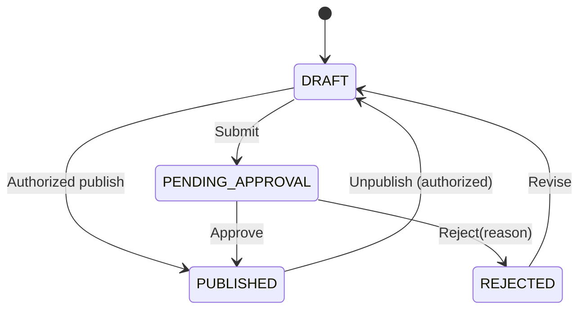

# AI VIBE-CODING IMPLEMENTATION PACK
## Hướng dẫn giao việc cho AI Coding Agent / Cursor / Claude Code / Codex / Copilot

**Đọc trước khi code:** `01_PRD_Kho_Tai_Lieu_Bacnhabook.md` và `02_Backlog_User_Stories.md`.  
**Trạng thái:** Hướng dẫn triển khai **đề xuất**, không thay thế các yêu cầu **[CHỐT]**. Các điểm **OD-xx** phải được xác nhận bởi Product Owner/BA trước khi lập trình production.

## 1. Prompt nền để dán vào AI coding agent

> Bạn đóng vai Principal Engineer + Security Engineer + Senior QA. Hãy xây dựng website độc lập Kho tài liệu & Học liệu Bacnhabook – Nội bộ dựa trên PRD và backlog đính kèm. Đối với mỗi thay đổi phải gắn Story ID và Acceptance Criteria, không tự thêm tính năng hay thay đổi yêu cầu đã chốt. Mọi phân quyền phải kiểm tra ở backend; private R2, không lộ original object cho VIEW-only; Deny > Allow; bảo vệ truy vấn fulltext khỏi lộ snippet. Không được dùng fake APIs trong luồng production, không hardcode secrets, không vượt qua permission khi người dùng sửa URL. Nếu thiếu quyết định OD, ghi assumptions rõ và tạo blocker thay vì tự ý quyết. Hãy làm migration, seed, API spec, UI responsive, unit/integration/e2e tests, security test và file README triển khai. Mỗi story phải báo trạng thái AC Pass/Fail có bằng chứng. Không đổi Release 1 thành MVP cắt bớt phạm vi.

## 2. Stack gợi ý – tùy chỉnh theo hiện trạng team

| Layer | Đề xuất | Ghi chú |
|---|---|---|
| Frontend | Next.js + TypeScript, React, Tailwind, component library có khả năng accessibility | Responsive all roles, PDF/Office/media viewer |
| Backend | NestJS + TypeScript, REST API + OpenAPI/Swagger | Permission Guards + policy engine tập trung |
| Database | PostgreSQL + Prisma hoặc TypeORM | Transaction, indexes, migration, materialized ACL khi cần |
| Object Storage | Cloudflare R2 Private (S3-compatible) | Original & preview có prefix/bucket policy tách |
| Background jobs | Redis + BullMQ | Preview/scan/index/import/email/cleanup/backup |
| Fulltext | PostgreSQL FTS hoặc OpenSearch/Meilisearch (chọn sau benchmark & phân quyền) | Không index leak snippet |
| Preview | LibreOffice headless/PDF renderer, media transcoder worker | Sandbox/isolated workers |
| Email | SMTP/API provider có outbox, retry, rate limit | Không log raw password |
| Auth | Cookies httpOnly secure + server sessions/rotating refresh; Argon2id | MFA cho roles quản trị |
| Monitoring | Metrics/structured logs/tracing + alert | Audit append-only logic |

**Không tự triển khai DRM hoặc chỉnh sửa Office trực tuyến.** Định dạng bất kỳ được phép upload, nhưng preview chỉ cho loại file pipeline hỗ trợ.

## 3. Kiến trúc module monorepo đề xuất

```text
apps/
  web/                        # Next.js UI theo role
  api/                        # NestJS REST / Swagger
  worker/                     # BullMQ processors: file scan, preview, index, email, retention
packages/
  contracts/                  # DTO + validation schemas + API types
  authz/                      # ACL policy utilities, shared tests
  ui/                         # Components: FolderTree, Viewer, PermissionEditor, etc.
infra/
  db/migrations/
  r2/
  monitoring/
  backup/
tests/
  e2e/
  performance/
  security/
docs/
  decisions/                  # ADRs cho OD chưa chốt
```

**Backend modules:** Auth, Identity, Departments, Repositories, Folders, Documents, Versions, Uploads, Preview, ACL, Approval, AccessRequests, Metadata, Search, Lifecycle, Trash, Notifications, Audit, Dashboard, Storage, Backup.

## 4. API design đề xuất (REST contract outline)

| Method | Endpoint | Security |
|---|---|---|
| POST | /auth/login | rate limit + MFA admin |
| POST | /auth/change-initial-password | authenticated + must-change |
| POST | /auth/forgot-password | public throttled |
| POST | /auth/reset-password | one-time token |
| POST | /auth/logout | revoke session |
| GET/POST | /users | HCNS/Super Admin scope; Bacnhabook Admin chỉ Customer |
| POST | /customers/imports | Bacnhabook Admin + scope |
| GET | /imports/:jobId | uploader + scope |
| GET/POST | /repositories | list filtered, Super Admin create |
| GET/POST | /folders | scope authorization |
| PATCH/DELETE | /folders/:id | manage + soft delete |
| POST | /uploads/init | MANAGE target Folder; signed R2 upload |
| POST | /uploads/:id/complete | verify upload + scan queue |
| POST | /uploads/folder-batch | manage Folder, relative paths |
| GET | /documents | listing policy vs view-right distinct |
| GET/PATCH/DELETE | /documents/:id | MANAGE for mutation |
| POST | /documents/:id/versions | MANAGE + chosen mode |
| POST | /documents/:id/versions/:versionId/restore | MANAGE |
| GET | /documents/:id/preview-ticket | VIEW + Published/Active policy |
| GET | /documents/:id/download-ticket | DOWNLOAD + downloadable=true |
| POST/DELETE | /grants | GRANT in target scope; Deny precedence |
| POST | /permissions/check | server computed result for UI (not security boundary alone) |
| POST | /documents/:id/access-requests | authenticated, throttled |
| PATCH | /access-requests/:id | Grant authority in scope |
| GET/PUT | /folders/:id/approvers | approver policy management |
| POST | /documents/:id/submit-approval | MANAGE + state validation |
| POST | /documents/:id/approval-decision | APPROVE in folder scope |
| GET/POST | /metadata/definitions | scope control |
| GET | /search | scope filtering + no unauthorized excerpts |
| GET/PATCH | /notifications | own account only |
| GET | /audit | admin + scoped filter |
| GET | /dashboard | scope-based aggregates |
| GET/PUT | /storage/alerts | Super Admin config |
| POST | /backup/restore | Super Admin / ops with additional safety |

**API response envelope đề xuất:** `{ "data": ..., "error": { "code": "FORBIDDEN", "message": "..." }, "requestId": "..." }` theo convention cụ thể của dự án. Tránh trả chi tiết tài liệu/ID không có quyền từ endpoint bảo mật.

## 5. Thuật toán phân quyền tham chiếu (pseudo-code)

```ts
function authorize(user, target, action, now) {
  if (!isPublishedAndAccessible(target, action, now)) return DENY;
  const grants = collectEffectiveGrants(user, target, action, now);
  // grants: direct user, department, folder ancestors, specific document
  if (grants.some(g => g.effect === 'DENY')) return DENY;
  if (target.accessType === 'PUBLIC' && action === 'VIEW') return ALLOW;
  if (grants.some(g => g.effect === 'ALLOW')) return ALLOW;
  return DENY;
}
function canDownload(user, doc, now) {
  return doc.downloadable && authorize(user, doc, 'DOWNLOAD', now) === ALLOW;
}
```

**Cảnh báo thiết kế:** `PUBLIC` và explicit Deny cần thống nhất xung đột ở OD trước khi finalize; bản pseudo-code hiện ưu tiên Deny. `manage/admin roles` phải là permission độc lập, không suy từ VIEW. Listing metadata của Private chưa có VIEW khác với xem full file/content. Recheck authorization trước mọi preview/download, không tin client permission flags. Cần xử lý cache quyền hết hạn và revoke.

## 6. State machines

### 6.1 Publication



### 6.2 Upload processing

```text
initiated → uploading → uploaded → scanning → processing_preview/index → ready
                  ↘ failed         ↘ quarantined          ↘ processing_failed
```

### 6.3 Lifecycle (độc lập Publication)

```text
scheduled → active → expired → archived
              ↘ superseded (replacement linked)
```

### 6.4 Access Request

```text
pending → approved | rejected | cancelled
```

Các transition phải validate bằng backend và có Audit Log; không để FE tùy ý PATCH status.

## 7. Security checklist bắt buộc

- [ ] R2 bucket private; signed upload/download hạn ngắn; không chứa secret keys ở frontend.
- [ ] ACL Deny precedence cả ancestors, user & department, signed URLs cấp mới sau permission check.
- [ ] VIEW-only không trả original file qua download endpoint; preview separate; media session secured.
- [ ] Không claim bảo vệ 100% khỏi screenshot / screen recording / devtools.
- [ ] Password khởi tạo sinh bằng CSPRNG, hash Argon2id/bcrypt strong, plaintext không vào DB/log/Audit.
- [ ] Ép đổi mật khẩu đầu, MFA admin, login throttling, idle auto logout, session/device constraints.
- [ ] MIME sniffing/AV scanning; renderer sandbox; file chưa scan không public.
- [ ] Import Excel chống formula injection khi export, validate rows/idempotency.
- [ ] SSRF/XSS/CSRF/IDOR/SQL injection/presigned misuse tests.
- [ ] Search luôn lọc snippet theo View; metadata filename BR-09 có privacy risk đã ghi OD-02.
- [ ] Per-repository scoping (Bacnhabook Admin không vào HCNS; manager không vào kho khác).
- [ ] Download watermark policy apply cho viewer; overlay có thể bị che/bypass, nhận diện giới hạn.
- [ ] Retention legal hold; backup độc lập, object consistency, restore test.
- [ ] Secret management, IaC least privilege và audit trail.

## 8. Thứ tự chạy coding trong một release (không cắt phạm vi)

| Wave | Mục tiêu triển khai | Exit criteria |
|---|---|---|
| 0 | Chốt OD critical, repo skeleton, CI/CD, data model | Lint/test/migration/staging sẵn sàng |
| 1 | Auth + Role + Repo/Folder + R2 + ACL | Các bài test không lộ dữ liệu đều pass |
| 2 | Upload Folder + Preview/Viewer + Download + Versions | Trải nghiệm PC/Mobile chính chạy ổn |
| 3 | Metadata + Search + Import Excel + Notifications | Tìm đúng quyền, batch idempotent |
| 4 | Approval + Lifecycle + Trash + Dashboard + Audit | Các quy trình quản trị và analytics chạy ổn |
| 5 | Level B security + Backup/Restore + load test + UAT | Pass BR-01…BR-38, sẵn sàng bàn giao một release |

**Cấm dùng “Wave 1 live production” làm MVP nếu người yêu cầu chưa đổi BR-39.** Có thể demo từng wave trên staging.

## 9. Seed data / acceptance fixtures không dùng dữ liệu thật

```text
Repos:
  BOOKS (BACNHABOOK) / HSK3 / Bai01 / slide.pptx, audio.mp3, video.mp4
  COMMON / QuyTrinhCongTy / quytrinh.pdf
  HR / QuyetToan2026 / ho_so_abc.pdf
  DEPT_MKT / Campaign2027 / brief.docx
Users:
  customer_1@example.test  Customer  Allow HSK3
  customer_2@example.test  Customer  no Allow HSK3
  employee_mkt@example.test Employee  Dept=MKT
  employee_fin@example.test Employee  Dept=FINANCE
  manager_mkt@example.test DepartmentManager scope=DEPT_MKT
  hr_admin@example.test HR Admin scope=HR
  book_admin@example.test Bacnhabook Admin scope=BOOKS
  root_admin@example.test Super Admin
ACL cases:
  Allow Dept=MKT VIEW(DEPT_MKT)
  Deny employee_mkt VIEW(DEPT_MKT/Campaign2027/brief.docx)
  Allow employee_fin VIEW(DEPT_MKT/Campaign2027/brief.docx)
  Expiring Allow customer_1 VIEW(BOOKS/HSK3)
```

**Test security nên chạy cả HTTP trực tiếp**, không chỉ click UI; log mọi failed permission test.

## 10. Mẫu prompt chạy từng Story

```text
Task: Implement story [STORY_ID] from 02_Backlog_User_Stories.md.
Read: PRD section/BR mapping + existing architecture + relevant OD issues.
Return BEFORE coding:
1. Brief implementation plan and file changes;
2. Schema/API/UI contracts;
3. Permission checks and negative tests;
4. Questions/blockers if acceptance criteria cannot be met.
Then implement:
- DB migration and seed fixture;
- API + validation + authz;
- UI responsive and error states;
- Unit, integration and E2E test;
- Audit, notification, background job if relevant.
Report AFTER coding:
- AC-by-AC PASS/FAIL with test commands/output;
- DB migration notes and rollback;
- Security/privacy assumptions;
- screenshots and known limitations.
Do not claim completed if any AC not demonstrated.
```

## 11. Không được quên khi dùng AI vibe-coding

1. **AI không là nguồn quyết định nghiệp vụ:** nêu điểm OD cần BA chốt thay vì lựa chọn mặc định ngầm.
2. **Không mock hóa production flows:** email, R2, download, ACL, audit phải là luồng thật; có thể mock trên staging/dev.
3. **Không chỉ làm UI:** story hoàn thành khi cả backend, migration, worker, security và test đã chạy.
4. **Không bỏ qua edge cases:** Folder move, grant expiry, Deny conflict, import duplicate, expired link, restore, broken preview, deleted version.
5. **Không cam kết SLA hay Man-month khi chưa estimate:** BR-40 còn trống, BR-38 mới là baseline capacity.

